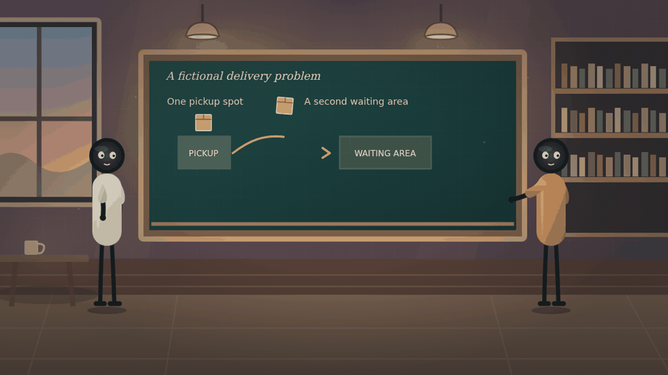

<div align="center">

# Cinematic Narrative Video

### An agent skill for original animated stories, explainers, and videos in any niche.

**Turn an idea into a clear story, a visual plan, and—when your agent has the right tools—a finished video.**

[](.agents/skills/cinematic-narrative-video/SKILL.md)
[](mcp/README.md)
[](mcp/README.md)
[](LICENSE)

[Quick start](#quick-start) · [How it works](#how-it-works) · [What’s included](#whats-included) · [Examples](#examples) · [FAQ](#faq) · [Documentation](#documentation)

</div>

---

Cinematic Narrative Video gives an AI agent a reusable production workflow: understand your topic and audience, develop an original script, design characters and environments, plan motion and sound, and review the result. Use it for science, business, history, education, fiction, productivity, or another niche—not just the subject of the visual reference.

The skill is an instruction package. Your agent supplies the creative, code-drawing, speech, animation, rendering, and review capabilities. The optional MCP server helps read guides, scaffold projects, and check basic timing; it **does not** create a finished video, images, or speech by itself.

<div align="center">



<sub>An original silent technique study, not the reference video or a finished production.</sub>

</div>

## Quick start

### Installation

Paste this prompt into your agent, such as Claude Code, Codex, or OpenCode:

```text
Install the cinematic-narrative-video skill from https://github.com/selther-core/animated-video-skill-mcp. Set up its MCP server if supported and permitted, then verify the installation.
```

The agent should follow the host's documented skill location, preserve existing files and settings, and request approval where needed. MCP is optional; agents without native skill support can read the skill as project instructions.

If you have a newer downloaded ZIP, give that file to the agent and use this instead. The GitHub copy may be older than the ZIP if local changes have not been pushed.

```text
Install the cinematic-narrative-video skill from the provided ZIP. Set up its MCP server if supported and permitted, then verify the installation.
```

### Download and verify manually

```sh
git clone https://github.com/selther-core/animated-video-skill-mcp.git
cd animated-video-skill-mcp
python3 tests/test_mcp.py
```

Python 3.9+ is required for the optional MCP server and tests, not for reading the skill. For native skill discovery, copy the entire `.agents/skills/cinematic-narrative-video/` directory to the location documented by your agent, without overwriting existing files. Reload the agent and verify discovery. Or provide that directory as ordinary project context if your agent does not support skills. See [agent compatibility](.agents/skills/cinematic-narrative-video/references/agent-compatibility.md).

To connect the optional server, keep the repository in a stable location and follow the [MCP setup guide](mcp/README.md). Configuring MCP and installing a native skill are separate steps. The MCP server uses Python's standard library; `ffprobe` is optional and only needed for its video-metadata tool.

### When you are ready to create

After installation, enter your own video prompt. The agent first understands it, then asks one grouped round about backgrounds, length, video type, niche/audience and voice, acknowledging choices already supplied. You may say “choose for me.” After your answers, it begins production. For example:

```text
Use cinematic-narrative-video to plan an original 60-second animated story
about a nervous fox learning to share, for families, in 16:9. If your tools
allow it, create the video, captions, and an original thumbnail. Review what
you can and clearly report anything you could not make or check.
```

A text-only agent can help with scripts and plans, but cannot honestly claim to have rendered, watched, or listened to a video without the necessary capabilities.

## How it works

1. **Prompt and questions:** read the user’s prompt; ask about backgrounds, length, type, niche/audience and American-accent voice, then begin after the answers. Installation alone does not start a project.
2. **Brief and selection:** pick scene candidates and clothing by beat, context, continuity and user preferences.
3. **Story:** develop an original hook and story beats, plus narration or dialogue when appropriate to the niche.
4. **Visuals and sound:** plan environments, subjects, storyboards, motion and any requested voice/sound cues. Draw visuals with HTML/CSS, SVG or Canvas; use agent-native TTS when available. Do not use image-generation models.
5. **Production:** create original assets and animate, render, and encode them using tools the agent actually has.
6. **Review and delivery:** check factual claims, media, captions, rights, and platform requirements; provide a thumbnail and publishing notes where requested. Report any checks that could not be completed.

The target is the visual quality and production grammar observed in the user-provided New project reference, with original actions, characters and scenes adapted to the topic. The supplied reference media is not bundled, and the included silent study is not a guarantee of equivalent quality. Static slides with camera pans, captions or weather are not a substitute for animation. The concise entry point uses detailed guides on demand, so depth is available without loading every guide for every project. The included demo is silent, and no voice recordings or reference audio are bundled.

## What’s included

| Component | Purpose |
|---|---|
| [Skill](.agents/skills/cinematic-narrative-video/SKILL.md) | The main instructions, evidence limits, production workflow, and review checklist. |
| [Reference quality comparison](.agents/skills/cinematic-narrative-video/references/reference-quality.md) | Sampled New project observations, documentary failure analysis, motion, light and sync checks. |
| [Animated-film blueprint](.agents/skills/cinematic-narrative-video/references/animation-blueprint.md) | Scene progression, animated action and an anti-slideshow gate. |
| [Detailed production manual](.agents/skills/cinematic-narrative-video/references/production-manual.md) | In-depth timelines, animation, audio, rendering, QA and publishing, loaded only when needed. |
| [Prompt-first intake](.agents/skills/cinematic-narrative-video/references/intake.md) | The five production questions, defaults and when to start. |
| [Scene and wardrobe selection](.agents/skills/cinematic-narrative-video/references/scene-wardrobe.md) | Context-aware locations, costumes, lighting and continuity. |
| [Code animation and reference breakdown](.agents/skills/cinematic-narrative-video/references/code-animation.md) | How to build reference-inspired visuals from code, plus a comparison of a prior output. |
| [Story structure and review](.agents/skills/cinematic-narrative-video/references/story-structure.md) | Genre-aware beat planning, within-shot progression, and evidence-tagged criteria. |
| [WWII example breakdown](.agents/skills/cinematic-narrative-video/references/ww2-example-breakdown.md) | Timestamped structure and limitations of the project-authored sample. |
| [Cinematic staging](.agents/skills/cinematic-narrative-video/references/cinematic-staging.md) | Layered backgrounds, lighting, cutaways, movement and shot review. |
| [Niche adaptation](.agents/skills/cinematic-narrative-video/references/niche-adaptation.md) | Adapt story, characters, visuals, and evidence to different subjects. |
| [Character rig](.agents/skills/cinematic-narrative-video/references/character-rig.md) and [voice direction](.agents/skills/cinematic-narrative-video/references/voice-direction.md) | Editable-character planning; energetic, clear American-accent voice types by niche, delivery notes, and TTS-ready scripts. |
| [Examples](.agents/skills/cinematic-narrative-video/examples/) | Cross-niche scripts, a storyboard, a timeline, and silent HTML animation demos. |
| [Original visual assets](.agents/skills/cinematic-narrative-video/assets/README.md) | Editable SVG illustrations with PNG previews. |
| [Reference frames](.agents/skills/cinematic-narrative-video/reference-frames/README.md) | Ten project-authored WWII example stills with provenance and limitations. |
| [Optional MCP server](mcp/README.md) | Local stdio tools, guide resources, and a prompt for compatible agents. |

### MCP tool catalog

| Tool | What it does | Important limitation |
|---|---|---|
| `read_skill_guide` | Reads a bundled guide. | Instructions are not media-generation tools. |
| `create_video_project` | Creates a new project with draft files and folders. | Refuses existing destinations; it does not generate media. |
| `check_story_plan` | Checks manually supplied beat fields and event bounds. | Does not inspect media or judge quality, facts or sync. |
| `validate_timeline` | Checks basic shot coverage and cue timing. | Does not verify actual media, sync, quality, rights, or accuracy. |
| `check_alignment` | Checks caller-supplied event IDs and time overlap. | Does not see or hear actual media, verify labels or prove synchronization. |
| `make_srt` | Converts supplied timed cues to subtitles. | Does not transcribe or align audio. |
| `inspect_video` | Returns technical metadata through an installed `ffprobe`. | Does not watch, listen to, or judge the video. |

The server also exposes sixteen guide resources and a `create_niche_video` prompt. Client support for resources and prompts varies. See the [MCP guide](mcp/README.md) for setup, privacy, and troubleshooting.

## Examples

- [Seekable HTML renderer](.agents/skills/cinematic-narrative-video/examples/render_seekable.py) — optional local renderer for authored `window.seek(t)` scenes; it does not create animation or TTS.
- [Original progressive quality study](.agents/skills/cinematic-narrative-video/examples/progressive-quality-demo.html) — a silent, seekable example with layered light, a moving prop, an evolving scene and a camera change.
- [Silent WWII visual source](.agents/skills/cinematic-narrative-video/examples/ww2-seekable-scene.html) — editable, seekable visual reconstruction of the project-authored example; no audio included.
- [Cross-niche scripts and storyboards](.agents/skills/cinematic-narrative-video/examples/cross-niche-scripts.md) — business, productivity, fiction, and other sample directions.
- [Sample script and board](.agents/skills/cinematic-narrative-video/examples/example-script-and-board.md) — narration, visual planning, and edit notes.
- [Character rig illustration](.agents/skills/cinematic-narrative-video/assets/character-rig.png) and [editable SVG](.agents/skills/cinematic-narrative-video/assets/character-rig.svg) — an older generic joint map, not the long-body rig.
- [Progressive scene demo](.agents/skills/cinematic-narrative-video/examples/progressive-scene-demo.html) and [beat template](.agents/skills/cinematic-narrative-video/examples/story-beat-template.json) — a silent, fictional example of visual states changing within one location.
- [Long-body rig and staging demo](.agents/skills/cinematic-narrative-video/examples/staging-rig-demo.html) — runnable silent example of layered scenery, lighting, character anatomy and a cutaway.
- [Older silent vector animation demo](.agents/skills/cinematic-narrative-video/examples/backyard-vector-demo.html) — original coded scene, rig and diagram; not a finished video.

These are starting points. Adapt them to the brief and create original final artwork, scripts, and audio.

## FAQ

<details>
<summary><strong>Which agents can use it?</strong></summary>

Agents that can read the skill files can use them as instructions. Some hosts also support native skills, local stdio MCP, or media-generation tools. Setup and discovery depend on the host and version; consult its documentation and verify the connection rather than assuming it works.

</details>

<details>
<summary><strong>Do I need MCP?</strong></summary>

No. The skill can be used directly as instructions. MCP adds guide access, project scaffolding, timing and subtitle helpers, and optional metadata inspection; it does not replace an animation or TTS tool.

</details>

<details>
<summary><strong>Can it create videos in any niche?</strong></summary>

The workflow is designed to adapt to many niches and genres, including fiction, tutorials, commentary, and explainers. The quality and completeness of a finished video depend on the agent's available tools, the brief, permissions, and review.

</details>

<details>
<summary><strong>Can I reuse the reference stills?</strong></summary>

The ten stills come from project-authored visuals in the fictional WWII cut. They are provided under the repository MIT license; see the [source and rights notice](.agents/skills/cinematic-narrative-video/reference-frames/README.md). No voice or soundtrack is included.

</details>

<details>
<summary><strong>Is my project private?</strong></summary>

The MCP server runs locally and does not itself explicitly upload files or include telemetry. Your agent, model provider, external tools, and their configuration may process or transmit information. `ffprobe` parses supplied files and is not sandboxed by this project. See [SECURITY.md](SECURITY.md).

</details>

## Documentation

- [Skill instructions](.agents/skills/cinematic-narrative-video/SKILL.md) — full workflow and reference-analysis limits.
- [MCP setup and tools](mcp/README.md) — client configuration, tool behavior, privacy, and troubleshooting.
- [Agent compatibility](.agents/skills/cinematic-narrative-video/references/agent-compatibility.md) — skill-aware, MCP-capable, and text-only workflows.
- [Code animation guide](.agents/skills/cinematic-narrative-video/references/code-animation.md) — observed differences, code-based construction, rendering and style-test requirements.
- [Prompt-first intake](.agents/skills/cinematic-narrative-video/references/intake.md) — user questions before production.
- [Scene and wardrobe selection](.agents/skills/cinematic-narrative-video/references/scene-wardrobe.md) — meaningful, niche-specific choices.
- [Story structure](.agents/skills/cinematic-narrative-video/references/story-structure.md) — genre-appropriate narrative beats and evidence-tagged review.
- [Cinematic staging](.agents/skills/cinematic-narrative-video/references/cinematic-staging.md) — backgrounds, lighting, cutaways, animation and QA.
- [Visual reference analysis](.agents/skills/cinematic-narrative-video/references/visual-reference.md) — observations and their limitations.
- [Security policy](SECURITY.md) — private reporting and the local server's security boundary.
- [License](LICENSE) — permission to use and modify project-authored material, subject to its terms.

Run the included tests from the repository root with `python3 tests/test_mcp.py`. They exercise the local protocol and helpers; they do not test every agent host or prove a finished video can be produced.

## Contributing

Issues and pull requests are welcome for improvements to the skill, documentation, examples, and MCP server. Keep examples original, preserve third-party notices, avoid committing private media or credentials, and run the tests before proposing changes. For security issues, follow [SECURITY.md](SECURITY.md) instead of posting sensitive details publicly.

## License and credits

Copyright © 2026 **Haziq Mahmood**. Project-authored code, documentation, and original example assets are available under the [MIT License](LICENSE): you may use, modify, and distribute them, including commercially, provided you retain the copyright and permission notice as required by the license. MIT applies only to material the project is entitled to license and comes without warranty.

The current project-authored example stills are covered by that grant; see the [frame notice](.agents/skills/cinematic-narrative-video/reference-frames/README.md). No rights to third-party music, voices, video, fonts, or tools are granted by this repository.
