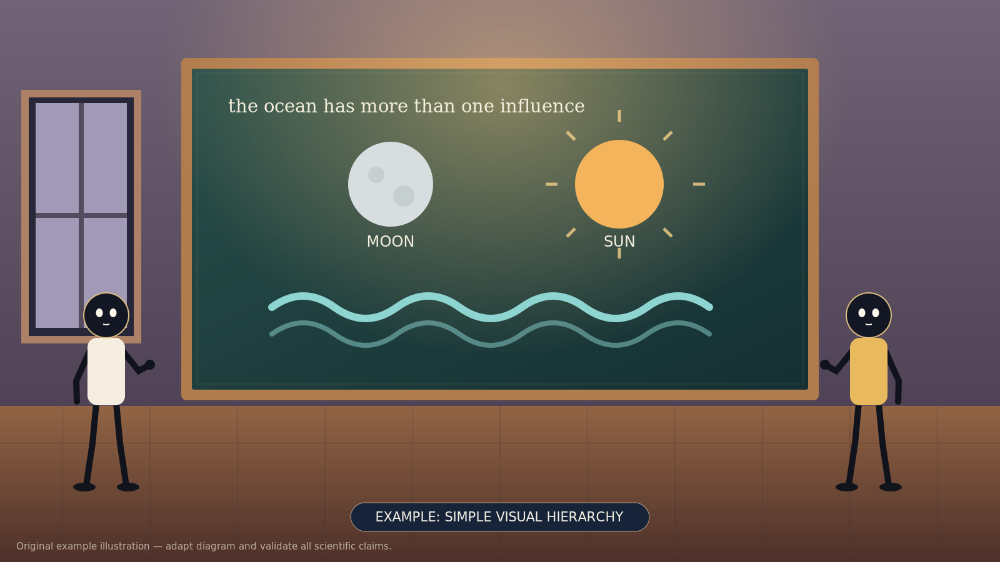

<div align="center">

# Cinematic Narrative Video

### An agent skill for original animated stories, explainers, and videos in any niche.

**Turn an idea into a clear story, a visual plan, and—when your agent has the right tools—a finished video.**

[](.agents/skills/cinematic-narrative-video/SKILL.md)
[](mcp/README.md)
[](mcp/README.md)
[](LICENSE)

[Quick start](#quick-start) · [How it works](#how-it-works) · [What’s included](#whats-included) · [Examples](#examples) · [FAQ](#faq) · [Documentation](#documentation)

</div>

---

Cinematic Narrative Video gives an AI agent a reusable production workflow: understand your topic and audience, develop an original script, design characters and environments, plan motion and sound, and review the result. Use it for science, business, history, education, fiction, productivity, or another niche—not just the subject of the visual reference.

The skill is an instruction package. Your agent supplies the actual creative, image, speech, animation, rendering, and review capabilities. The optional MCP server helps read guides, scaffold projects, and check basic timing; it **does not** create a finished video, images, or speech by itself.

<div align="center">



<sub>An original example illustration, not a frame from the reference video or a finished production.</sub>

</div>

## Quick start

### Installation

Copy and paste this installation prompt into your agent. It is suitable for agents such as Claude Code, Codex, OpenCode, and Arena when they have the relevant file access and permissions:

```text
Install the cinematic-narrative-video skill from:
https://github.com/selther-core/animated-video-skill-mcp

Identify what this agent supports. Clone or download the repository into the
workspace if permitted. Read .agents/skills/cinematic-narrative-video/SKILL.md
and mcp/README.md. Keep the entire skill directory and its supporting files
together; do not overwrite existing files or settings.

If this agent supports native skills, copy the entire skill directory to the
host's documented skill location and verify discovery. If native skills are not
supported, make the skill file and its supporting files available as ordinary
project instructions instead.

If the host supports local stdio MCP and configuration is permitted, register the
repository's MCP server using mcp/README.md. Run the tests and verify the connection.
MCP is optional: if it cannot be installed, the skill can still be used through its
instructions. Obtain any required approval before changing host settings.

Report what was installed, how I can invoke it, and any step you could not verify.
Do not create a video or ask for a video topic yet.
```

### Download and verify manually

```sh
git clone https://github.com/selther-core/animated-video-skill-mcp.git
cd animated-video-skill-mcp
python3 tests/test_mcp.py
```

Python 3.9+ is required for the optional MCP server and tests, not for reading the skill. For native skill discovery, copy the entire `.agents/skills/cinematic-narrative-video/` directory to the location documented by your agent, without overwriting existing files. Reload the agent and verify discovery. Or provide that directory as ordinary project context if your agent does not support skills. See [agent compatibility](.agents/skills/cinematic-narrative-video/references/agent-compatibility.md).

To connect the optional server, keep the repository in a stable location and follow the [MCP setup guide](mcp/README.md). Configuring MCP and installing a native skill are separate steps. The MCP server uses Python's standard library; `ffprobe` is optional and only needed for its video-metadata tool.

### When you are ready to create

Ask your agent to use `cinematic-narrative-video` and give it a topic, niche, audience, desired length, format, and any requirements. For example:

```text
Use cinematic-narrative-video to plan an original 60-second animated story
about a nervous fox learning to share, for families, in 16:9. If your tools
allow it, create the video, captions, and an original thumbnail. Review what
you can and clearly report anything you could not make or check.
```

A text-only agent can help with scripts and plans, but cannot honestly claim to have rendered, watched, or listened to a video without the necessary capabilities.

## How it works

1. **Brief:** define the subject, audience, tone, length, format, and constraints.
2. **Story:** develop an original hook, narration, dialogue, and story beats suited to the niche.
3. **Visuals and sound:** plan characters, environments, poses, storyboards, motion, TTS-ready text, and sound cues. Use agent-native image or TTS tools when available.
4. **Production:** create original assets and animate, render, and encode them using tools the agent actually has.
5. **Review and delivery:** check factual claims, media, captions, rights, and platform requirements; provide a thumbnail and publishing notes where requested. Report any checks that could not be completed.

The visual approach is inspired by a **partially inspected** reference excerpt, not an exact recreation. The included demo is silent, and no voice recordings or reference audio are bundled.

## What’s included

| Component | Purpose |
|---|---|
| [Skill](.agents/skills/cinematic-narrative-video/SKILL.md) | The main instructions, evidence limits, production workflow, and review checklist. |
| [Niche adaptation](.agents/skills/cinematic-narrative-video/references/niche-adaptation.md) | Adapt story, characters, visuals, and evidence to different subjects. |
| [Character rig](.agents/skills/cinematic-narrative-video/references/character-rig.md) and [voice direction](.agents/skills/cinematic-narrative-video/references/voice-direction.md) | Editable-character planning and written TTS/voice guidance. |
| [Examples](.agents/skills/cinematic-narrative-video/examples/) | Cross-niche scripts, a storyboard, a timeline, and a silent HTML animation demo. |
| [Original visual assets](.agents/skills/cinematic-narrative-video/assets/README.md) | Editable SVG illustrations with PNG previews. |
| [Reference frames](.agents/skills/cinematic-narrative-video/reference-frames/README.md) | Eight third-party stills for visual study, with source and rights information. |
| [Optional MCP server](mcp/README.md) | Local stdio tools, guide resources, and a prompt for compatible agents. |

### MCP tool catalog

| Tool | What it does | Important limitation |
|---|---|---|
| `read_skill_guide` | Reads a bundled guide. | Instructions are not media-generation tools. |
| `create_video_project` | Creates a new project with draft files and folders. | Refuses existing destinations; it does not generate media. |
| `validate_timeline` | Checks basic shot coverage and cue timing. | Does not verify actual media, sync, quality, rights, or accuracy. |
| `make_srt` | Converts supplied timed cues to subtitles. | Does not transcribe or align audio. |
| `inspect_video` | Returns technical metadata through an installed `ffprobe`. | Does not watch, listen to, or judge the video. |

The server also exposes seven guide resources and a `create_niche_video` prompt. Client support for resources and prompts varies. See the [MCP guide](mcp/README.md) for setup, privacy, and troubleshooting.

## Examples

- [Cross-niche scripts and storyboards](.agents/skills/cinematic-narrative-video/examples/cross-niche-scripts.md) — business, productivity, fiction, and other sample directions.
- [Sample script and board](.agents/skills/cinematic-narrative-video/examples/example-script-and-board.md) — narration, visual planning, and edit notes.
- [Character rig illustration](.agents/skills/cinematic-narrative-video/assets/character-rig.png) and [editable SVG](.agents/skills/cinematic-narrative-video/assets/character-rig.svg) — a sample joint map.
- [Silent puppet demo](.agents/skills/cinematic-narrative-video/examples/puppet-demo.html) — a small local visual demonstration, not a finished video.

These are starting points. Adapt them to the brief and create original final artwork, scripts, and audio.

## FAQ

<details>
<summary><strong>Which agents can use it?</strong></summary>

Agents that can read the skill files can use them as instructions. Some hosts also support native skills, local stdio MCP, or media-generation tools. Setup and discovery depend on the host and version; consult its documentation and verify the connection rather than assuming it works.

</details>

<details>
<summary><strong>Do I need MCP?</strong></summary>

No. The skill can be used directly as instructions. MCP adds guide access, project scaffolding, timing and subtitle helpers, and optional metadata inspection; it does not replace an animation or TTS tool.

</details>

<details>
<summary><strong>Can it create videos in any niche?</strong></summary>

The workflow is designed to adapt to many niches and genres, including fiction, tutorials, commentary, and explainers. The quality and completeness of a finished video depend on the agent's available tools, the brief, permissions, and review.

</details>

<details>
<summary><strong>Can I reuse the reference stills?</strong></summary>

The eight stills are from a third-party video and are not licensed under this repository's MIT license. Inclusion here does not grant reuse or redistribution rights. Read the [source and rights notice](.agents/skills/cinematic-narrative-video/reference-frames/README.md) and obtain permission or another lawful basis where needed.

</details>

<details>
<summary><strong>Is my project private?</strong></summary>

The MCP server runs locally and does not itself explicitly upload files or include telemetry. Your agent, model provider, external tools, and their configuration may process or transmit information. `ffprobe` parses supplied files and is not sandboxed by this project. See [SECURITY.md](SECURITY.md).

</details>

## Documentation

- [Skill instructions](.agents/skills/cinematic-narrative-video/SKILL.md) — full workflow and reference-analysis limits.
- [MCP setup and tools](mcp/README.md) — client configuration, tool behavior, privacy, and troubleshooting.
- [Agent compatibility](.agents/skills/cinematic-narrative-video/references/agent-compatibility.md) — skill-aware, MCP-capable, and text-only workflows.
- [Visual reference analysis](.agents/skills/cinematic-narrative-video/references/visual-reference.md) — observations and their limitations.
- [Security policy](SECURITY.md) — private reporting and the local server's security boundary.
- [License](LICENSE) — permission to use and modify project-authored material, subject to its terms.

Run the included tests from the repository root with `python3 tests/test_mcp.py`. They exercise the local protocol and helpers; they do not test every agent host or prove a finished video can be produced.

## Contributing

Issues and pull requests are welcome for improvements to the skill, documentation, examples, and MCP server. Keep examples original, preserve third-party notices, avoid committing private media or credentials, and run the tests before proposing changes. For security issues, follow [SECURITY.md](SECURITY.md) instead of posting sensitive details publicly.

## License and credits

Copyright © 2026 **Haziq Mahmood**. Project-authored code, documentation, and original example assets are available under the [MIT License](LICENSE): you may use, modify, and distribute them, including commercially, provided you retain the copyright and permission notice as required by the license. MIT applies only to material the project is entitled to license and comes without warranty.

The third-party reference stills are **not** covered by that grant. They are attributed to the original source and subject to their rights holder's terms; see the [reference-frame notice](.agents/skills/cinematic-narrative-video/reference-frames/README.md). No rights to third-party music, voices, video, fonts, or tools are granted by this repository.
